# Workflows

Every workflow the product offers today, drawn from the code (controllers, services, lifecycle enums, security rules and
frontend routes) as of 2026-11-04. The diagrams are [Mermaid](https://mermaid.js.org/); GitHub renders them in the browser.

Where a diagram and a specification disagree, the specification wins (`specs/specv3.md` > `specs/architect.md` >
`specs/frontend-spec.md`). Endpoint details are in `docs/implementation/API_CONTRACT.md`.

| # | Workflow | Who |
|---|----------|-----|
| 1 | [Actors and what each may reach](#1-actors-and-what-each-may-reach) | everyone |
| 2 | [Sign-in and landing page](#2-sign-in-and-landing-page) | everyone |
| 3 | [Platform administration: create a tenant](#3-platform-administration-create-a-tenant) | platform administrator |
| 4 | [Scoring configuration: layers and precedence](#4-scoring-configuration-layers-and-precedence) | system |
| 5 | [Configuration version lifecycle](#5-configuration-version-lifecycle) | owner, administrator, analyst (read) |
| 6 | [Configuration change: draft to active](#6-configuration-change-draft-to-active) | owner, administrator |
| 7 | [Questionnaire builder](#7-questionnaire-builder) | owner, administrator |
| 8 | [Roster: teams and people](#8-roster-teams-and-people) | owner, administrator |
| 9 | [Assessment run, end to end](#9-assessment-run-end-to-end) | managers and respondents |
| 10 | [Respondent flow](#10-respondent-flow) | respondent |
| 11 | [Scoring through the API](#11-scoring-through-the-api) | owner, administrator, engineering leader |
| 12 | [The scoring pipeline](#12-the-scoring-pipeline) | system |
| 13 | [Reading results](#13-reading-results) | every tenant role |
| 14 | [Reports](#14-reports) | every tenant role |
| 15 | [Audit and observability](#15-audit-and-observability) | system |
| 16 | [Role and endpoint matrix](#16-role-and-endpoint-matrix) | reference |

---

## 1. Actors and what each may reach

Five tenant roles come from the `roles` claim of the token; the platform administrator and the respondent are deliberately
not in the `Role` enum. The tenant and the organizations always come from the token, never from a request.

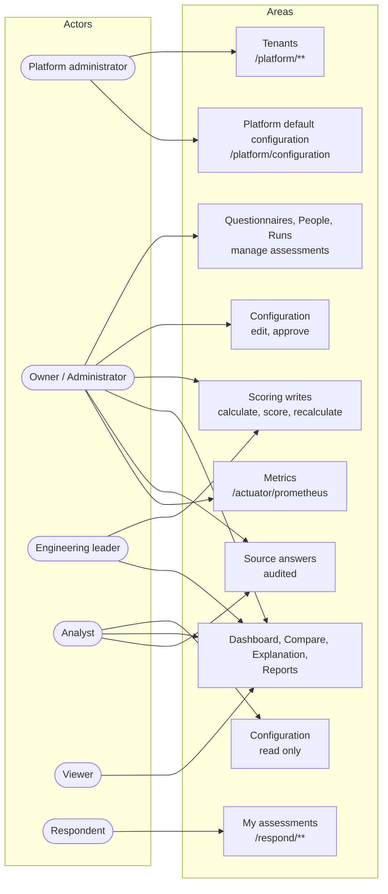

Notes:

- The platform administrator belongs to no tenant and reaches nothing tenant-scoped (a tenant-scoped read returns 403).
- Viewers read results with values withheld ("redacted"); owners, administrators and analysts see the full values.
- Respondents reach only `/api/v1/respond/**`.

---

## 2. Sign-in and landing page

The web UI signs in with the OpenID Connect authorization-code flow (with PKCE). Locally the identity provider is the mock
server in `docker-compose.yml`; the login page offers one button per sample persona. Tokens are kept in `sessionStorage`
(cleared with the tab). The backend is a resource server: it validates the signature against the provider's key set and
fails closed when no key set is configured.

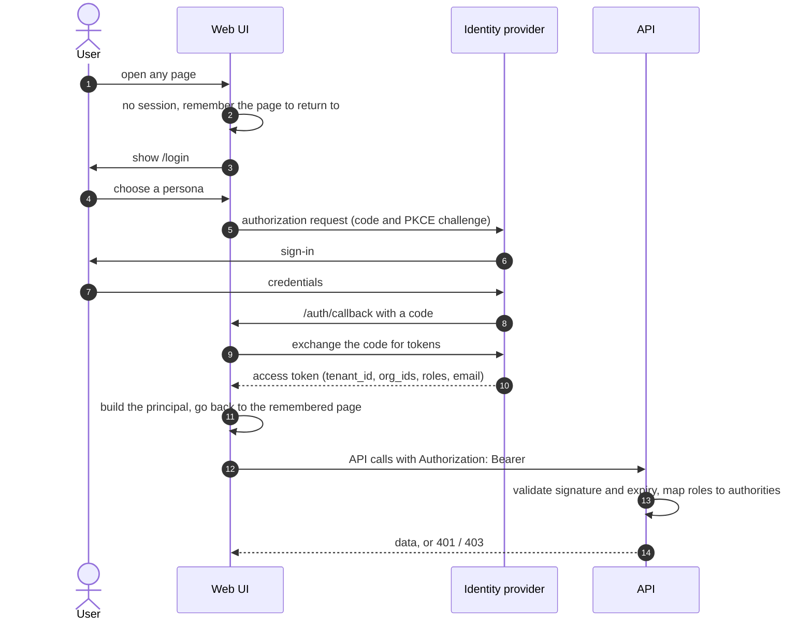

Where each principal lands (`frontend/src/app/layouts/nav.ts`):

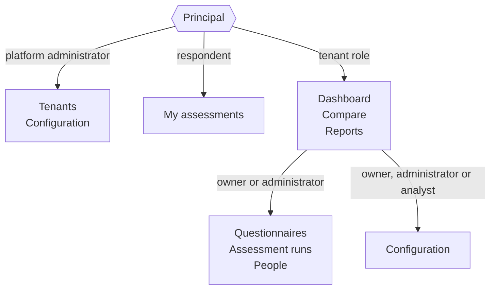

---

## 3. Platform administration: create a tenant

A tenant is an id (permanent) and a name only. Creating and listing tenants are audited.

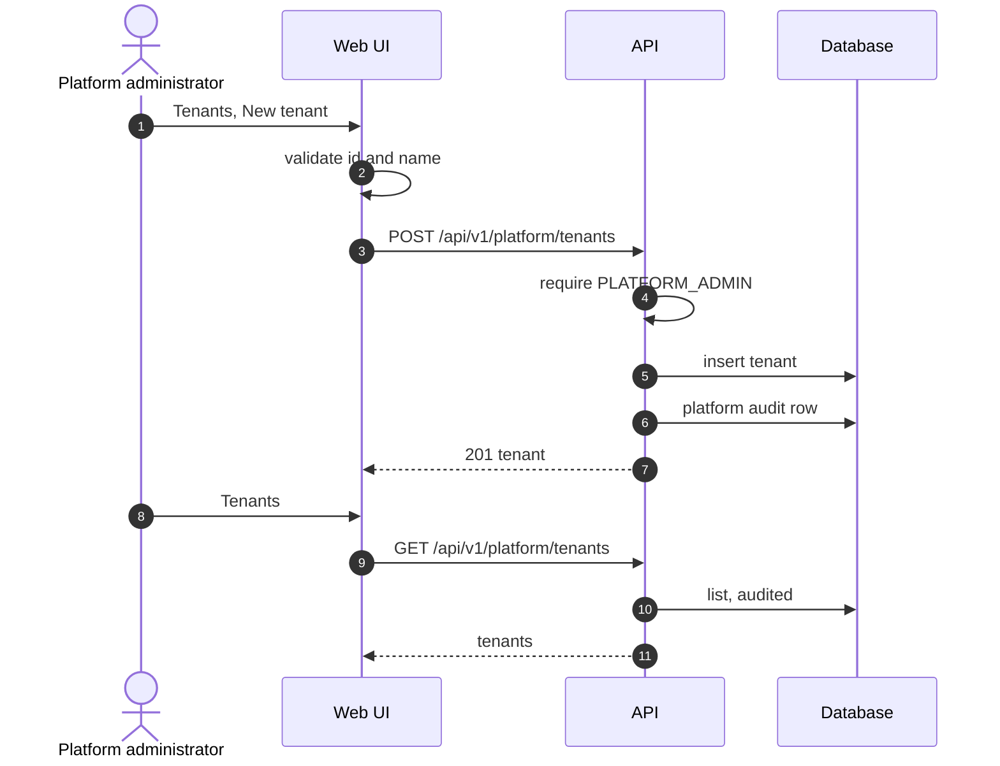

---

## 4. Scoring configuration: layers and precedence

All scoring rules are versioned configuration, never code. A run resolves one effective configuration, once, in this order
(later layers override earlier ones):

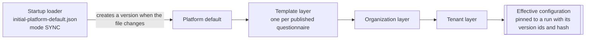

- The platform default is `src/main/resources/config/initial-platform-default.json`: an initial, **unvalidated** proposal.
  An invalid file stops startup. The `dev` profile loads a separate illustrative sample instead.
- An active version is never edited. A change is a new version.
- Every run stores the engine version, algorithm version, configuration version and hash, input hash and rounding policy
  version, so it can be explained and replayed later.

---

## 5. Configuration version lifecycle

`ConfigurationStatus` (decision D33). Only `DRAFT` is editable and only `ACTIVE` versions score new runs.

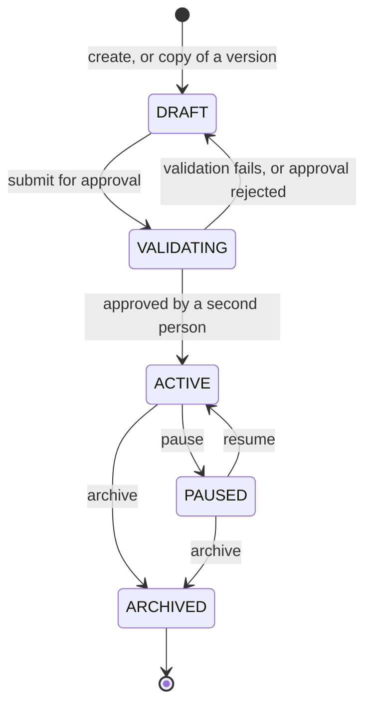

Activating a version supersedes the previously active version of the same layer (one active version per layer).

---

## 6. Configuration change: draft to active

The Configuration screens (decisions D52 to D58). The approver must be a different person from anyone who created, edited or
submitted the version (switchable with `lis.configuration.approval.require-second-person`), approval needs a written note,
and a failing fixture blocks approval.

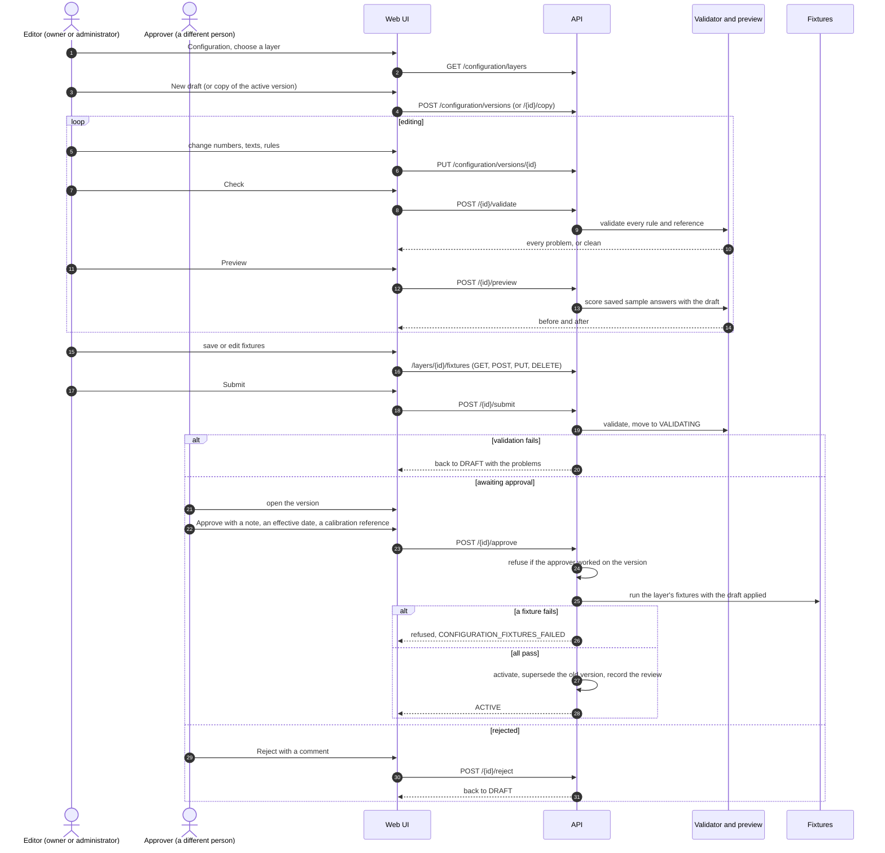

After activation an owner or administrator can pause, resume or archive the version. The platform administrator manages the
platform default layer through `/api/v1/platform/configuration`; tenants manage theirs through `/api/v1/configuration`.
Template layers are generated by the questionnaire builder and are not edited here.

---

## 7. Questionnaire builder

Owners and administrators author questionnaires in the builder. Publishing generates a validated TEMPLATE layer through the
configuration lifecycle in one transaction; the questionnaire id is the template id. Free-text questions are collected and
never scored.

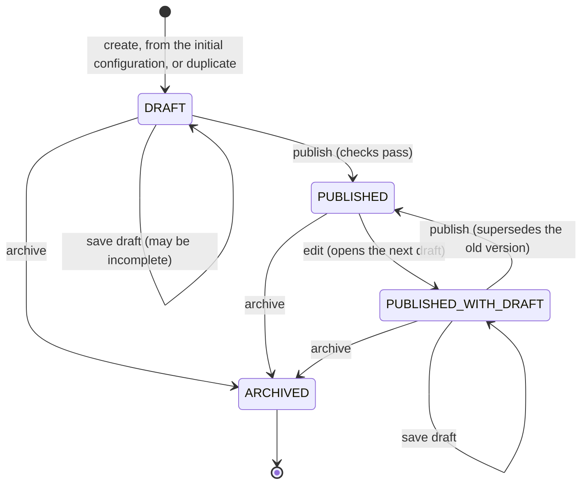

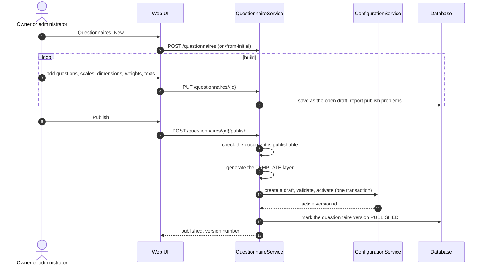

Archiving hides a questionnaire from new use. Its published layer stays active so past assessments can still be explained and
recalculated.

---

## 8. Roster: teams and people

Teams and people form the roster that runs draw on. People are matched to respondents by their `email` claim. Nobody is ever
listed with scores; members are an input scope only.

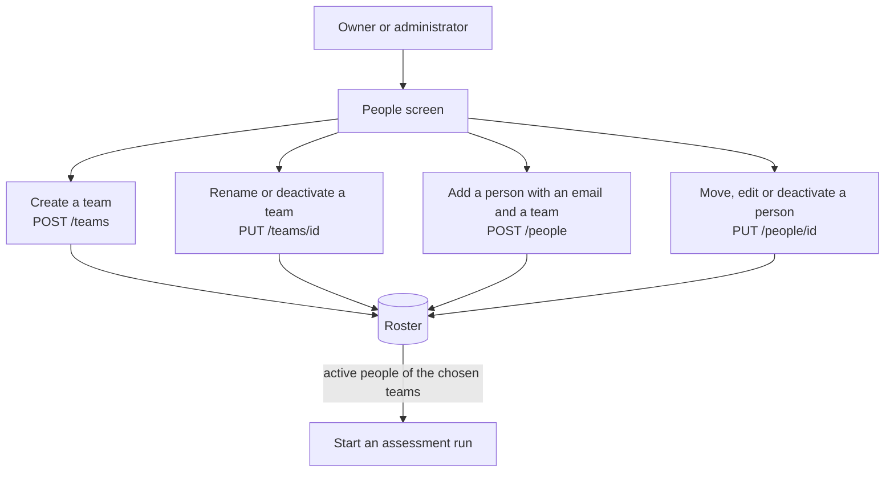

---

## 9. Assessment run, end to end

An assessment run pins a published questionnaire version and its configuration version, and snapshots one participant per
active person of the chosen teams. Closing the run scores the submitted answers once.

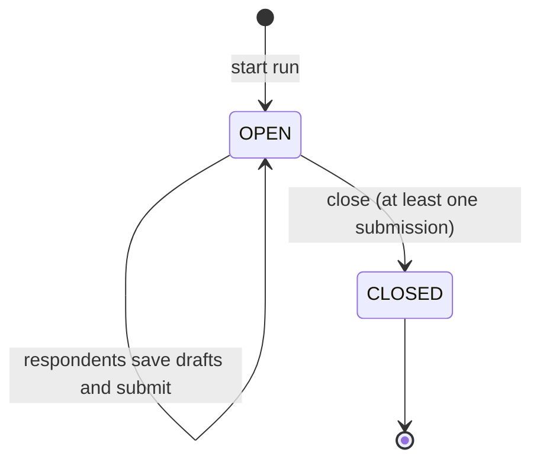

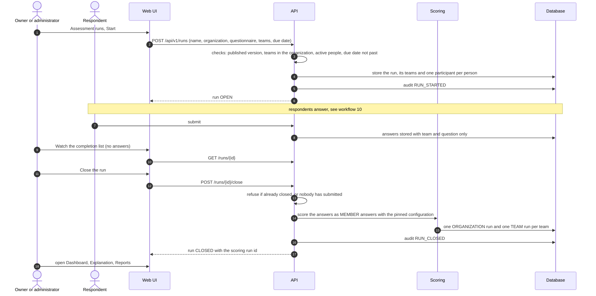

A scoring failure rolls everything back and leaves the run open.

---

## 10. Respondent flow

Answers are stored with the team and the question only: no person, no time, a random id. The draft is linked to the
participant so it can be resumed, and is deleted on submit.

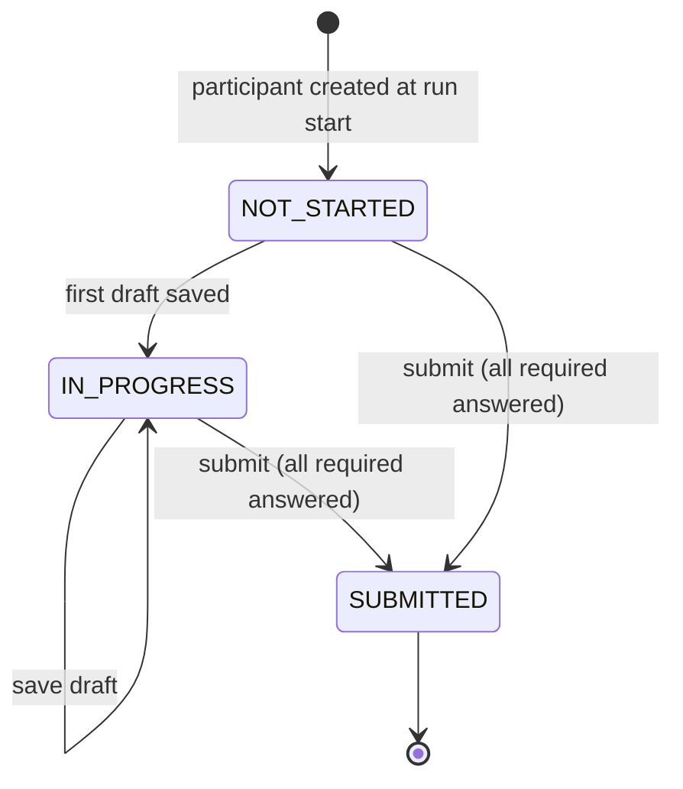

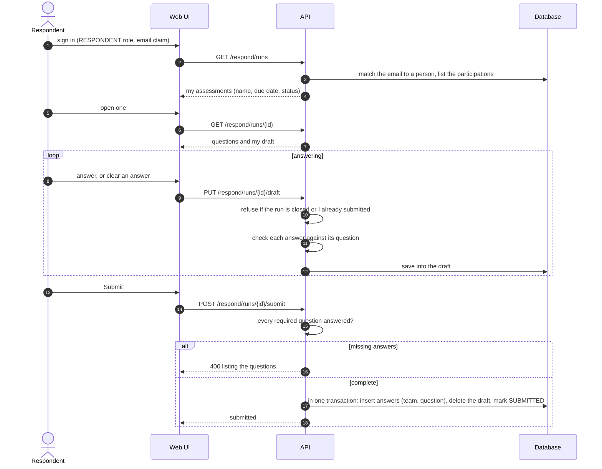

---

## 11. Scoring through the API

Integrations can score without a questionnaire run. No request may carry configuration, weights or a tenant override. All
three scoring writes accept an `Idempotency-Key`: a repeat of the same request returns the stored result, and the same key
with a different request is refused.

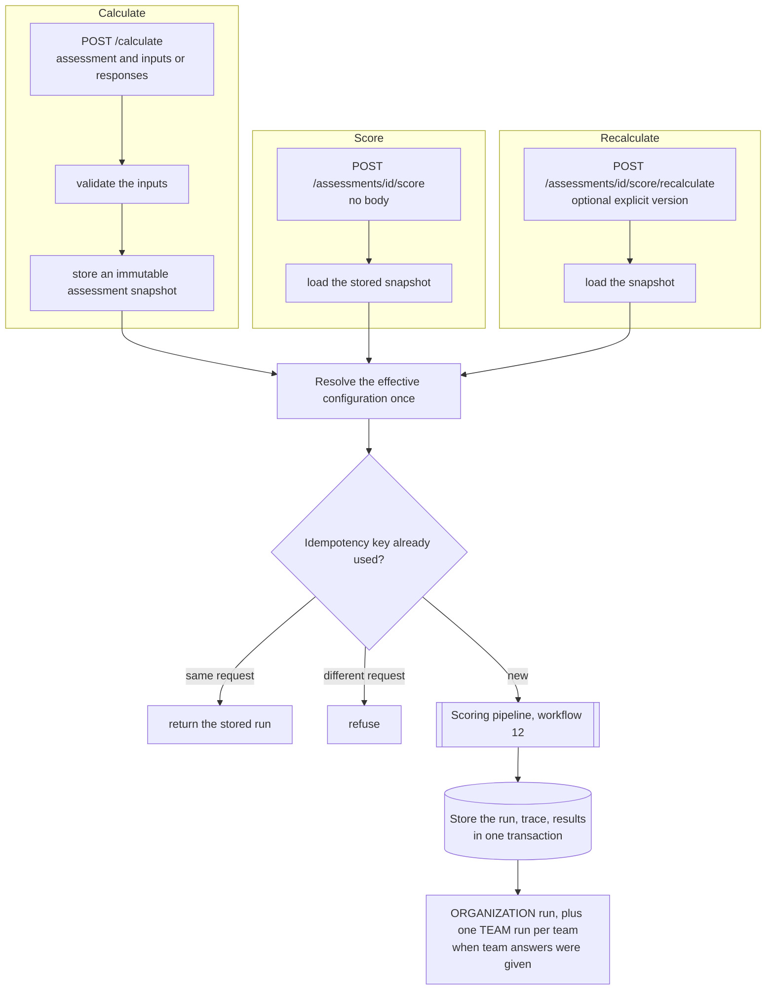

Reads of a stored run: `GET /assessments/{id}/score` (latest), `GET /scoring-runs/{id}`, `/explanation`, `/dimensions`,
`/patterns`, `/penalties`, `/imbalances`, and `/answers` (owner, administrator, analyst; audited).

---

## 12. The scoring pipeline

Deterministic: the same inputs, configuration version and engine version always give the same result. Explanations come from
the recorded facts and never recompute a score. Missing data is never treated as zero; too little data gives
`INSUFFICIENT_DATA`, not an invented number.

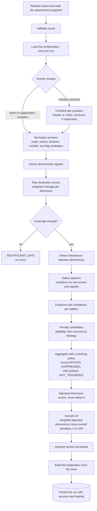

Dimensions: `TEAM_HEALTH`, `DELIVERY_STABILITY`, `TECHNICAL_RISK`, `LEADERSHIP_LOAD`. For every score, 100 is the desirable
state and 0 the undesirable one.

---

## 13. Reading results

All of these only read stored runs and never score. They are tenant- and organization-scoped.

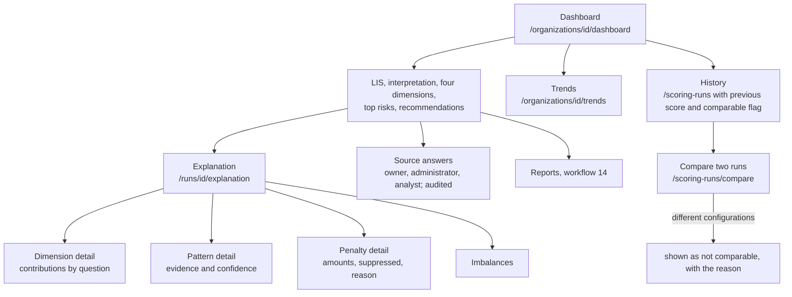

Viewers see the same screens with per-question values withheld. The catalog endpoint
(`/scoring-runs/{id}/catalog`) supplies display text and score bands, so labels come from configuration.

---

## 14. Reports

Generated on demand from the stored run, trace, catalog and recommendations; never stored and never recalculated. They
contain no answers and nothing per member. Each generation is audited as `REPORT_GENERATED` (type, format, redacted flag;
never the content).

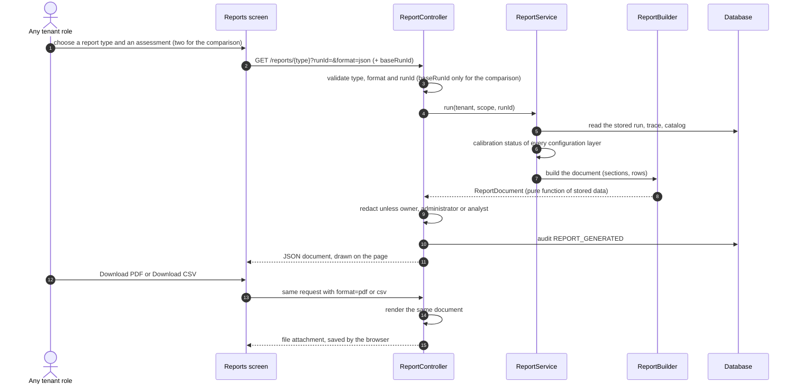

Report types: `LEADERSHIP_INTELLIGENCE`, `DIMENSION_ANALYSIS`, `PATTERN_PENALTY`, `HISTORICAL_COMPARISON`. The methodology
block says "Unvalidated" unless every configuration layer has a calibration reference.

---

## 15. Audit and observability

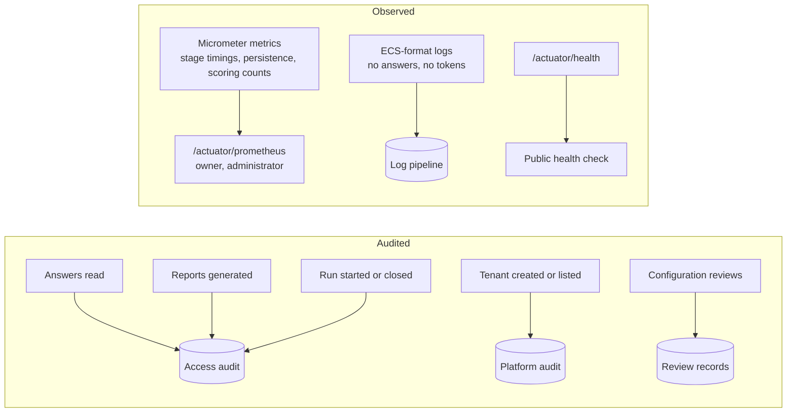

Audit rows record who and how many, never what: no answer text and no report content.

---

## 16. Role and endpoint matrix

| Area | Endpoints | Platform admin | Owner / Admin | Eng. leader | Analyst | Viewer | Respondent |
|------|-----------|:---:|:---:|:---:|:---:|:---:|:---:|
| Tenants | `/platform/tenants` (GET, POST) | yes | no | no | no | no | no |
| Platform default configuration | `/platform/configuration/**` | yes | no | no | no | no | no |
| Tenant configuration, edit | `/configuration/**` (writes) | no | yes | no | no | no | no |
| Tenant configuration, read | `/configuration/**` (GET) | no | yes | no | yes | no | no |
| Questionnaires | `/questionnaires/**` | no | yes | no | no | no | no |
| Roster | `/teams/**`, `/people/**` | no | yes | no | no | no | no |
| Assessment runs | `/runs/**` | no | yes | no | no | no | no |
| Respond | `/respond/**` | no | no | no | no | no | yes |
| Scoring writes | `/calculate`, `/assessments/*/score`, `/score/recalculate` | no | yes | yes | no | no | no |
| Source answers (audited) | `/scoring-runs/*/answers` | no | yes | no | yes | no | no |
| Read results | `GET /assessments`, `/scoring-runs/**`, `/organizations/**` | no | yes | yes (values withheld) | yes | yes (values withheld) | no |
| Reports | `/reports/{type}` | no | yes | yes (values withheld) | yes | yes (values withheld) | no |
| Metrics | `/actuator/prometheus`, `/actuator/metrics` | no | yes | no | no | no | no |
| Health | `/actuator/health` | public | public | public | public | public | public |

"Values withheld" means the redaction rule `!hasAnyRole(OWNER, ADMIN, ANALYST)`. Authority is derived from the `roles`
claim; the tenant and the organizations (`org_ids`) come only from the token.
